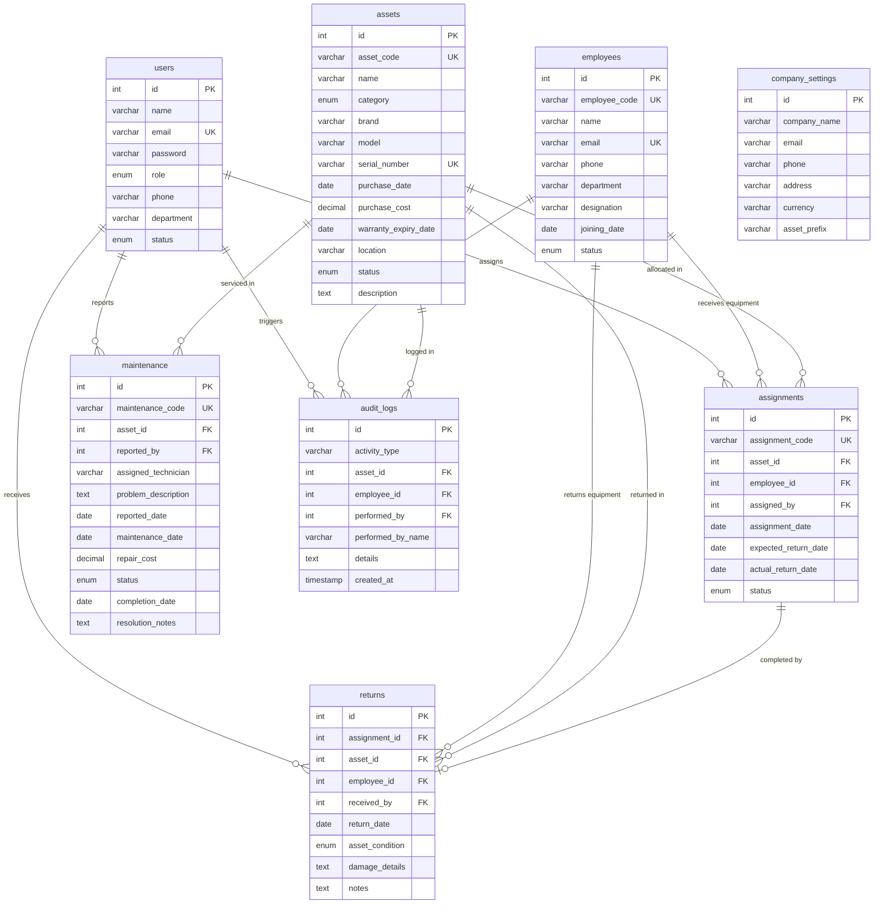

# Corporate Asset Management System (AssetCore OS)

A production-grade, responsive, full-stack enterprise web application built with **React (Vite)**, **Node.js**, **Express.js**, and a normalized **MySQL** relational database.

Designed to meet and exceed college major project and enterprise SaaS asset tracking standards.

---

## 1. System Overview & Architecture

AssetCore OS streamlines physical and digital hardware tracking throughout its operational lifecycle: from acquisition and custody assignment to damage intake, technician repair workflows, and immutable compliance auditing.

### Key Highlights
- **Role-Based Access Control (RBAC):** Distinct permission tiers for `Admin`, `IT Staff`, and `Employee`.
- **Database Transaction Integrity:** ACID-compliant allocation handovers and return intakes with automatic status updates (`Available` ↔ `Assigned` ↔ `Under Maintenance`).
- **Condition-Triggered Maintenance:** Returning damaged assets automatically schedules prioritized repair tickets and dispatches service notices.
- **Append-Only Immutable Audit Trail:** Complete audit history capturing every insertion, update, assignment, return, and login event with zero client-side tamper capability.
- **Real-Time Data Visualizations:** Dynamic Recharts graphs powered directly by live MySQL aggregation queries.
- **Export & Print Ready:** Instant CSV exports and formatted printable reports for hardware capital auditing.

---

## 2. Technology Stack

### Frontend
- **Framework:** React 19 with Vite 8
- **Styling:** Tailwind CSS with custom SaaS typography (`Plus Jakarta Sans`)
- **Routing:** React Router DOM (with protected route guards)
- **Icons:** Lucide React
- **Data Visualizations:** Recharts (Donut charts, Area charts, Bar graphs)
- **HTTP Client:** Axios with JWT Bearer token request/response interceptors

### Backend
- **Runtime:** Node.js v24
- **Framework:** Express.js REST API
- **Authentication:** JSON Web Tokens (JWT) & Bcrypt password hashing
- **Database Driver:** `mysql2/promise` with connection pooling
- **Security & Logging:** CORS, Morgan HTTP logger, role-based authorization middleware

### Database
- **Engine:** MySQL 8.0 InnoDB
- **Database Name:** `corporate_asset_management`
- **Normalization:** 3NF relational schema with foreign key constraints, unique indexing, and rollback transactions

---

## 3. Database Schema & Relational Design

The database comprises 8 interconnected tables:



---

## 4. Sample Demonstration Credentials

| Role | Email Address | Password | Permissions |
| :--- | :--- | :--- | :--- |
| **Admin** | `admin@corporate.com` | `Admin@123` | Full access to all 10 modules, User Management, and Company Settings. |
| **IT Staff** | `itstaff@corporate.com` | `Staff@123` | Asset CRUD, Assign Assets, Process Returns, Schedule/Update Maintenance. |
| **Employee** | `employee@corporate.com` | `User@123` | View assigned hardware, check return due dates, view inventory and personal history. |

> **Pro Tip:** On the Login page (`http://localhost:3000/login`), you can click any of the **Quick Demo Login** buttons (`👑 Admin`, `🛠️ IT Staff`, `👤 Employee`) to autofill and sign in with a single click!

---

## 5. Quick Start Instructions

### Prerequisites
1. **Node.js** (v18 or higher recommended; v24 installed)
2. **MySQL Server 8.0** running locally on port `3306`

### Option A: One-Click Windows Launcher
Double-click `start-system.bat` in the project root. This will:
1. Verify MySQL database connectivity and seed tables automatically if needed.
2. Launch the backend API on port `5000`.
3. Launch the React frontend on port `3000`.
4. Open your default web browser to `http://localhost:3000`.

---

### Option B: Running Manually

#### Step 1: Database Setup & Migration
1. Ensure your MySQL server is running.
2. Configure credentials in `backend/.env`:
   ```env
   PORT=5000
   DB_HOST=localhost
   DB_PORT=3306
   DB_USER=root
   DB_PASSWORD=@sathish20608
   DB_NAME=corporate_asset_management
   JWT_SECRET=corporate_asset_management_jwt_super_secret_key_2026_xyz
   ```
3. Run the automated seed script from the `backend/` folder:
   ```bash
   cd backend
   npm run seed
   ```

#### Step 2: Start the Backend API
```bash
cd backend
npm run dev
```
The backend server will run on `http://localhost:5000` with live MySQL connection.

#### Step 3: Start the Frontend Application
In a separate terminal window:
```bash
cd frontend
npm run dev
```
Access the application at: `http://localhost:3000`

---

## 6. Comprehensive REST API Documentation

### Authentication (`/api/auth`)
- `POST /api/auth/login` - Verify user credentials and generate JWT token
- `POST /api/auth/register` - Register a new system account
- `GET /api/auth/profile` - Get authenticated profile
- `PUT /api/auth/profile` - Update display name, phone, department
- `PUT /api/auth/change-password` - Update current user password with old password verification

### Assets Management (`/api/assets`)
- `GET /api/assets` - List assets with search (`q`), category filter, status filter, and sorting
- `GET /api/assets/available/list` - Fetch all assets with status `Available` for assignments
- `GET /api/assets/:id` - View single asset with active custodian and complete assignment/maintenance history
- `POST /api/assets` - Register a new asset (auto-generates asset ID like `AST-0021`)
- `PUT /api/assets/:id` - Update asset specifications and status
- `DELETE /api/assets/:id` - Safely remove asset (guarded against active assignments)

### Employee Management (`/api/employees`)
- `GET /api/employees` - List employees with department filter and assigned asset counts
- `GET /api/employees/:id` - View employee profile, currently allocated devices, and return history
- `POST /api/employees` - Onboard a new employee
- `PUT /api/employees/:id` - Update employee details
- `DELETE /api/employees/:id` - Delete employee (guarded against employees with active hardware custody)

### Asset Assignments (`/api/assignments`)
- `GET /api/assignments` - List assignments with status filter (`Active`, `Returned`) and search
- `GET /api/assignments/:id` - Get assignment agreement details
- `POST /api/assignments` - **Transactional Handover**: Locks asset, verifies `Available` status, sets asset to `Assigned`, and records audit log

### Asset Returns (`/api/returns`)
- `GET /api/returns` - List historical return intake records with condition notes
- `POST /api/returns` - **Transactional Intake**: Marks assignment as `Returned`. If condition is `Damaged`, automatically updates asset to `Under Maintenance` and creates a repair ticket. If healthy, updates asset to `Available`

### Maintenance & Service (`/api/maintenance`)
- `GET /api/maintenance` - List maintenance tickets with status filters (`Pending`, `In Progress`, `Completed`, `Cancelled`)
- `GET /api/maintenance/:id` - View maintenance ticket details
- `POST /api/maintenance` - Schedule repair ticket (sets asset status to `Under Maintenance`)
- `PUT /api/maintenance/:id` - Update repair cost, technician notes, or mark `Completed` (automatically restores asset to `Available`)

### Audit Trail (`/api/audit`)
- `GET /api/audit` - Searchable, append-only immutable audit trail filterable by activity type and date range

### Dashboard Analytics (`/api/dashboard`)
- `GET /api/dashboard/stats` - Total assets, available, assigned, maintenance, total valuation, pending returns
- `GET /api/dashboard/charts` - Dynamic chart datasets (categories, status breakdown, monthly trends)
- `GET /api/dashboard/recent-activities` - Real-time stream of the 10 most recent system operations

### Reports & Export (`/api/reports`)
- `GET /api/reports/assets` - Comprehensive asset report (JSON or CSV download with `?format=csv`)
- `GET /api/reports/employee-allocation` - Departmental allocation report (JSON or CSV)
- `GET /api/reports/returns` - Asset intake & damage log report (JSON or CSV)
- `GET /api/reports/maintenance` - Vendor repair cost report (JSON or CSV)
- `GET /api/reports/category-summary` - Capital valuation per category
- `GET /api/reports/purchase-depreciation` - 5-year straight line asset depreciation and book valuation

### Settings (`/api/settings`)
- `GET /api/settings/company` - Company metadata
- `PUT /api/settings/company` - Update company address, currency, and asset code prefix (Admin only)
- `GET /api/settings/users` - User directory (Admin only)
- `POST /api/settings/users` - Create user with specific role (Admin only)
- `PUT /api/settings/users/:id` - Update user role or toggle account active/inactive (Admin only)

---

## 7. Automated Test Suite

To execute the complete end-to-end integration test exercising all 10 modules, run:
```bash
npm test
```
Or directly:
```bash
cd backend
node scripts/testEndpoints.js
```
Expected output:
```
--- STARTING COMPLETE ENDPOINT & WORKFLOW VERIFICATION ---
✓ Admin login successful! Token received.
✓ Total Assets: 20 | Available: 7 | Assigned: 10
✓ Created asset with unique serial
✓ Created employee record
✓ Assignment transaction verified (Asset marked Assigned)
✓ Damaged return verified (Auto-maintenance ticket created & Asset marked Under Maintenance)
✓ Maintenance marked Completed (Asset status restored to Available)
✓ Audit history trail verified
✓ All reports & CSV exports verified
✓ Settings and RBAC verified
🎉 ALL 10 MODULES, WORKFLOWS, AND APIS VERIFIED WITH 100% SUCCESS!
```

---

## 8. College Project Evaluation Highlights

1. **True Full-Stack Implementation:** No mock data or localStorage-as-database cheats. All data lives in MySQL with foreign key constraints and ACID transaction protection.
2. **Complete Module Set:** All 10 requested modules (Dashboard, Assets, Employees, Assignments, Returns, Maintenance, Audit, Reports, Settings, Authentication) are fully implemented and functional.
3. **Enterprise UI/UX:** Styled using modern SaaS aesthetics (Dark Navy Blue, Royal Blue, clean white cards, subtle glows, responsive mobile drawer, skeleton loaders, and micro-animations).
4. **Interactive Demonstrations:** Quick 1-click login buttons allow instructors to test Admin, IT Staff, and Employee permissions in seconds.
